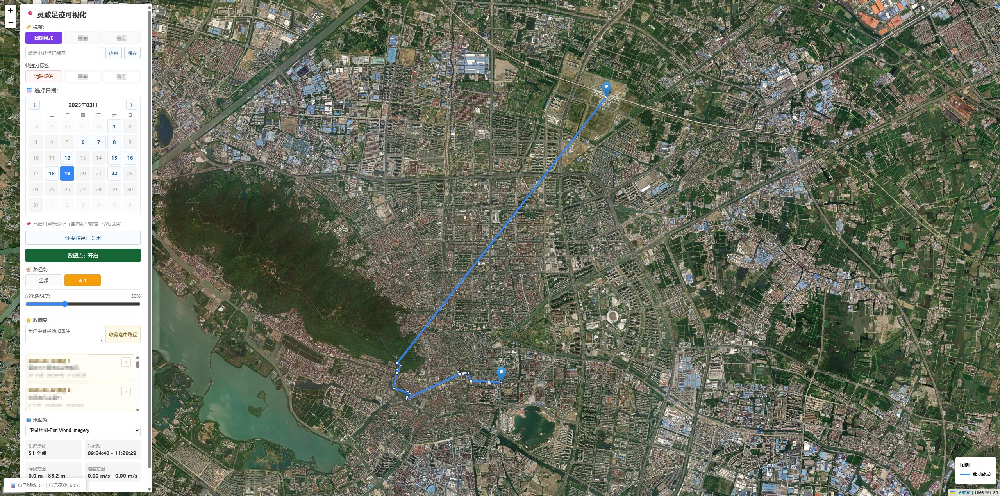

# 灵敢足迹 - 地理路径可视化

与“灵敢足迹”等足迹类APP适配的足迹管理展示的信息化网页程序。帮助你更好地从足迹信息中获取有用的信息。



## 📋 项目简介

APP的足迹记录的功能挺不错的，但是足迹多了之后管理可视化的水平是很差的。故本项目使用他们导出的足迹数据，进行数据清洗，接入各种地图瓦片服务，处理好了不同的地理坐标系的转换算法，并生成交互式的 Web 可视化页面。支持按日期查看轨迹、收藏与标签组织、多种地图源切换等功能。

## ✨ 功能特性

- **📅 日期选择**：通过日历视图选择不同日期查看当天的移动轨迹，仅有轨迹数据的日期可点击
- **🗺️ 地图源切换**：支持 OpenStreetMap、Esri World Imagery、天地图、星图地球、Tracestrack
- **📍 轨迹展示**：将离散的轨迹点聚类成轨迹并可视化
- **🏷️ 路径标签**：给多个路径进行Group。
- **⭐ 路径收藏**：对于一些具有纪念意义的时刻，将他们收藏在一个单独的地方，并且可以撰写文字备注、添加图片
- **📊 信息面板**：展示路径统计信息
- **⚪ 数据点显示**：可显示原始轨迹点
- **🏃 速度路径**：通过微分计算速度变化并用连续渐变路径显示
- **🔧 坐标纠正**：自动纠正国内 APP 产生的坐标偏移（GCJ-02 → WGS8

## 📁 数据文件说明

- `?.csv` - 原始轨迹数据（APP导出的文件）
- `data.db` - SQLite 数据库，包含轨迹点、路径标签和路径收藏 (本应用使用的所有个性化数据

## 🚀 使用方法

### 1. 数据准备

必须使用“灵感足迹”导出的原始 CSV 数据文件，格式应至少包含以下字段：

- `latitude` - 纬度
- `longitude` - 经度
- `geoTime` - 时间戳（毫秒）
- `dayTime` - 日期分组时间戳（秒）

### 2. 清洗 CSV 数据

如需先独立清洗 CSV，可运行：

```bash
npm run filter -- "灵敢足迹.csv" --in-place
```

清洗规则：按 `dayTime` 分组，如果某一天的数据点数量不超过阈值，则删除这一天的全部记录。默认阈值为 10。脚本只复制保留下来的原始行文本，不会重新格式化 CSV 字段、数字精度或引号。

可以通过 `--threshold` 调整阈值，例如删除每天数据点数量不超过 20 个的日期：

```bash
npm run filter -- "灵敢足迹.csv" --in-place --threshold 20
```

如果不想覆盖原文件，可以输出到新文件：

```bash
npm run filter -- "灵敢足迹.csv" -o "灵敢足迹_filtered.csv" --threshold 10
```

### 3. 生成数据

运行 Node 脚本生成数据：

```bash
npm run generate -- "灵敢足迹.csv"
```

脚本会：

- 读取命令行传入的 CSV 数据；如果没有 `date` 字段，会优先根据 `dayTime` 自动计算日期
- 生成 `data.db` SQLite 数据库中的轨迹数据
- 确保数据库和表结构已初始化

### 4. 启动 Node 服务

```bash
npm start
```

然后在浏览器中打开：

```text
http://localhost:3000
```

Node 服务会托管 `public/` 前端文件，并从 `data.db` SQLite 数据库提供轨迹数据、标签、收藏，同时提供标签保存接口、收藏保存接口和瓦片代理接口。

### 5. 数据

有些瓦片服务需要申请API key，填入`.env`。


数据链路是：

```text
CSV 原始轨迹
  -> scripts/filter-csv-days.mjs 清洗低质量日期
  -> scripts/generate-data.mjs 解析、分组、分段、跨天合并
  -> lib/db.mjs 写入 data.db
  -> server.mjs 提供 JSON API
  -> public/app.js 拉取并绘制地图
```


## 🔍 常见问题

### Q: 地图瓦片加载慢或无法显示？

**A**: 有些国内无法访问，有些需要申请API key

### Q: 坐标位置看起来不准确？

**A**: 火星坐标系的加密算法是国家机密，现在的只是一个公开的误差民用可以接受的算法。当然如果你的数据本来就是火星坐标系，编辑 `public/app.js` 文件中的 `correctCoord()` 函数。

## 📝 更新日志

### v2.0 (2026-05-05)

- ✅ 迁移到 Node.js 项目结构
- ✅ 拆分前端为 `public/index.html`、`public/styles.css`、`public/app.js`
- ✅ 新增 `scripts/generate-data.mjs`，替代 Python 数据生成流程
- ✅ 新增 `scripts/filter-csv-days.mjs`，替代 Python CSV 清洗流程
- ✅ 新增 `server.mjs`，提供本地服务和标签保存 API

### v1.0 (2026-05-02)

- ✅ 初始版本发布
- ✅ 支持日期选择和轨迹可视化
- ✅ 实现坐标自动纠正（GCJ-02 → WGS84）
- ✅ 添加多种地图源切换
- ✅ 数据外部化，提升页面加载速度
- ✅ 默认选中最新日期
- ✅ 修复时间格式显示问题
- ✅ 新增 CSV 清洗流程，支持按每天数据点数量清洗 CSV
- ✅ 更新数据生成流程，支持在没有 `date` 字段时自动计算日期
- ✅ 新增速度路径按钮，支持按渐变路径颜色查看速度快慢变化
- ✅ 新增按时间差自动切分路径段，并支持按钮网格多选突出显示
- ✅ 路径标签迁移到 SQLite 数据库，支持跨日期按标签显示路径
- ✅ 路径收藏迁移到 SQLite 数据库，支持收藏路径段和备注
- ✅ 生成 JSON 时支持跨天连续路径合并
- ✅ 新增数据点显示开关

## 📄 许可证

本项目为个人学习研究使用，数据文件请注意保护隐私
## 🙏 致谢

- [Leaflet.js](https://leafletjs.com/) - 优秀的开源地图可视化库
- [OpenStreetMap](https://www.openstreetmap.org/) - 提供地图瓦片服务
- Esri World Imagery - 提供卫星地图瓦片服务
- [天地图地图服务](http://lbs.tianditu.gov.cn/server/MapService.html) - 提供 WMTS 影像底图和影像注记服务

